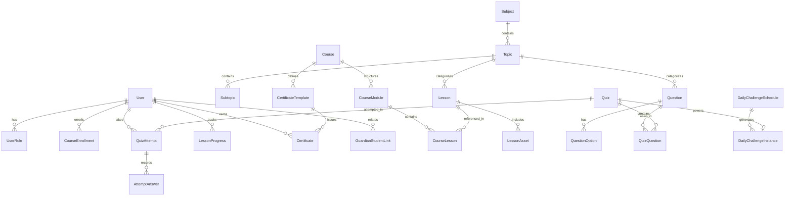

# DATABASE DESIGN & ENTITY-RELATIONSHIP MODEL

## 1. Relational Entity Overview
The database is built on **PostgreSQL** using **Prisma ORM**, enforcing strict relational integrity, UUID identifiers for security, composite indexes for high query performance, and cascading behaviors.

---

## 2. Table Schemas & Relationships

### 2.1 Identity & Authentication
- **User:** `id` (UUID), `name`, `email` (unique), `emailVerified`, `image`, `phoneNumber`, `gradeLevel`, `bengaliName`, `isActive`, `createdAt`, `updatedAt`
- **Account:** OAuth accounts (Better Auth / Google / Credentials)
- **Session:** User sessions with IP and userAgent
- **UserRole:** `id`, `userId`, `role` (`SUPER_ADMIN`, `ADMIN`, `TEACHER`, `CONTENT_EDITOR`, `MODERATOR`, `STUDENT`, `GUARDIAN`, `GUEST`), `assignedAt`
- **GuardianStudentLink:** `id`, `guardianId`, `studentId`, `relationship`, `isApproved`, `createdAt`

### 2.2 Academic Hierarchy & Organization
- **Subject:** `id`, `name` (e.g. "English"), `slug`, `description`, `icon`, `isPublished`
- **Topic:** `id`, `subjectId`, `name` (e.g. "Parts of Speech", "Articles", "Tenses"), `slug`, `orderIndex`
- **Subtopic:** `id`, `topicId`, `name` (e.g. "Definite Article 'The'", "Indefinite Articles 'A/An'"), `slug`
- **Cohort:** `id`, `name` (e.g. "Class 8 Grammar 2026"), `code` (unique invite code), `teacherId`, `startDate`, `endDate`
- **CohortMember:** `id`, `cohortId`, `userId`, `role`, `joinedAt`

### 2.3 Lessons & Educational Content
- **Lesson:** `id`, `title`, `slug` (unique), `summary`, `content` (Rich Text HTML / Markdown), `subjectId`, `topicId`, `gradeLevel` (e.g. "Class 6-8"), `difficulty` (`BEGINNER`, `INTERMEDIATE`, `ADVANCED`), `teacherId`, `thumbnailUrl`, `videoProvider` (`YOUTUBE`, `LOOM`, `DIRECT`, `MUX`), `videoUrl`, `durationMinutes`, `isPublished`, `publishedAt`, `createdAt`, `updatedAt`
- **LessonAsset:** `id`, `lessonId`, `title`, `assetType` (`PDF`, `WORKSHEET`, `AUDIO`, `SLIDE`), `fileUrl`, `fileSize`, `isDownloadable`
- **LessonProgress:** `id`, `userId`, `lessonId`, `isCompleted`, `lastPositionSeconds`, `completedAt`, `updatedAt` (Unique: `[userId, lessonId]`)

### 2.4 Courses & Curriculum
- **Course:** `id`, `title`, `slug` (unique), `description`, `thumbnailUrl`, `instructorId`, `subjectId`, `gradeRange`, `difficulty`, `isPublished`, `enrollmentType` (`PUBLIC`, `LOGIN_REQUIRED`, `INVITE_ONLY`), `certificateEnabled`, `createdAt`
- **CourseModule:** `id`, `courseId`, `title`, `orderIndex`
- **CourseLesson:** `id`, `moduleId`, `lessonId`, `orderIndex`, `isMandatory`
- **CourseEnrollment:** `id`, `courseId`, `userId`, `enrolledAt`, `completedAt`, `status` (`ACTIVE`, `COMPLETED`, `DROPPED`) (Unique: `[courseId, userId]`)

### 2.5 Question Bank & Assessments
- **Question:** `id`, `subjectId`, `topicId`, `subtopicId`, `gradeLevel`, `difficulty`, `type` (`SINGLE_MCQ`, `MULTIPLE_MCQ`, `TRUE_FALSE`, `FILL_BLANK`, `SHORT_ANSWER`, `LONG_ANSWER`, `MATCHING`, `ORDERING`, `DROPDOWN`, `PASSAGE_BASED`), `passageText` (nullable), `questionText`, `explanation`, `points` (default 1), `tags` (array), `isArchived`, `version` (int)
- **QuestionOption:** `id`, `questionId`, `optionKey` (e.g. "A", "B", "C"), `optionText`, `isCorrect` (boolean, hidden from client during attempts), `orderIndex`
- **Quiz:** `id`, `title`, `slug` (unique), `description`, `subjectId`, `topicId`, `courseId` (nullable), `lessonId` (nullable), `authorId`, `accessMode` (`PUBLIC_GUEST`, `AUTHENTICATED`, `COURSE_ONLY`, `COHORT_ONLY`, `INVITE_ONLY`), `resultVisibility` (`IMMEDIATE`, `AFTER_CLOSE`, `AFTER_TEACHER_APPROVAL`), `durationMinutes` (nullable for untimed), `passingScorePercent`, `startsAt`, `endsAt`, `isPublished`, `isDailyChallenge`
- **QuizQuestion:** `id`, `quizId`, `questionId`, `points`, `orderIndex`
- **QuizAttempt:** `id`, `quizId`, `userId` (nullable for guests), `guestSessionId` (nullable), `guestNickname` (nullable), `status` (`IN_PROGRESS`, `SUBMITTED`, `EXPIRED`, `PENDING_GRADING`, `GRADED`), `startedAt`, `expiresAt`, `submittedAt`, `scoreEarned`, `totalPossible`, `percentage`, `isPassed`
- **AttemptAnswer:** `id`, `attemptId`, `questionId`, `selectedOptionKeys` (JSON / string[]), `textAnswer` (nullable), `isCorrect` (nullable until graded), `awardedMarks`, `teacherFeedback`

### 2.6 Daily Grammar Challenge
- **DailyChallengeSchedule:** `id`, `dayOfWeek` (0=Sunday to 6=Saturday), `topicId`, `difficulty`, `questionCount` (default 5–10)
- **DailyChallengeInstance:** `id`, `scheduleId`, `challengeDate` (Date), `gradeLevel`, `quizId` (Unique: `[challengeDate, gradeLevel]`)
- **StudentStreak:** `id`, `userId`, `currentStreak`, `longestStreak`, `lastActiveDate`, `totalChallengesCompleted`

### 2.7 Certificates
- **CertificateTemplate:** `id`, `courseId`, `title`, `signatureUrl`, `signatoryTitle`, `badgeUrl`
- **Certificate:** `id`, `certificateNumber` (e.g. "RC-2026-XXXX"), `verificationCode` (UUID), `userId`, `courseId`, `studentName`, `courseTitle`, `issuedAt`, `pdfUrl`, `isRevoked`, `revocationReason`

### 2.8 Community & Forums
- **ForumCategory:** `id`, `name`, `slug`, `description`, `icon`, `minRoleToPost`, `orderIndex`
- **ForumThread:** `id`, `categoryId`, `authorId`, `courseId` (nullable for course-specific forum), `title`, `slug`, `content`, `isPinned`, `isLocked`, `viewCount`, `createdAt`
- **ForumPost:** `id`, `threadId`, `authorId`, `content`, `parentPostId` (nullable for nested replies), `isApproved`, `isReported`, `createdAt`
- **Conversation:** `id`, `studentId`, `teacherId`, `title`, `lastMessageAt`, `createdAt`
- **DirectMessage:** `id`, `conversationId`, `senderId`, `content`, `isRead`, `createdAt`

### 2.9 Notices & Notifications
- **Notice:** `id`, `title`, `content`, `priority` (`LOW`, `NORMAL`, `URGENT`), `audience` (`ALL`, `STUDENTS`, `TEACHERS`), `isPinned`, `publishedAt`, `expiresAt`
- **Notification:** `id`, `userId`, `title`, `message`, `linkUrl`, `type` (`COURSE`, `EXAM`, `GRADE`, `CERTIFICATE`, `COMMUNITY`, `SYSTEM`), `isRead`, `createdAt`
- **SiteSetting:** `id`, `key` (unique), `value` (JSON string), `description`, `updatedAt`
- **AuditLog:** `id`, `userId`, `action`, `resourceType`, `resourceId`, `metadata` (JSON), `ipAddress`, `createdAt`
