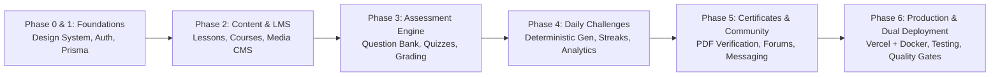

# IMPLEMENTATION PLAN — RIFFAT'S CLASSROOM

## Phase Progression & Acceptance Milestones

---

### Phase 1 — Foundation, Brand & Design System (Priority P0)
- **Next.js 16 Setup:** React 19, strict TypeScript, Tailwind CSS, Lucide icons, Radix UI primitives.
- **Brand Identity & Design Tokens:** Integrate Riffat's Classroom logo, primary magenta/pink `#ec4899`, deep slate teal `#0d4a4e`, sky blue, and warm accents.
- **Database Architecture:** Complete PostgreSQL schema with Prisma ORM, migrations, and realistic seed data (including English grammar lessons from confirmed teacher background).
- **Authentication & RBAC:** Multi-provider authentication (Google OAuth, Email OTP / Credentials), session management, and server authorization guards.
- **Responsive Public Layout:** Navigation, Hero, Category Cards, Featured Lessons preview, Teacher Intro, Footer.
- **Acceptance:** Application boots cleanly, authenticates users, enforces roles, and renders a welcoming, responsive public portal.

---

### Phase 2 — Lessons & Course Management (Priority P0)
- **Subject & Topic Hierarchy:** English Grammar, Vocabulary, Reading, Writing, Speaking.
- **Lesson Management:** Rich-text content, YouTube/Loom embeds, direct file uploads (Blob/local abstraction), downloadable worksheets, and lesson duration.
- **Course Builder:** Course ➔ Module ➔ Lesson curriculum builder with drag/order reordering.
- **Student Course Player:** Distraction-free sidebar navigation, progress persistence, next/prev lesson actions, and completion tracking.
- **Acceptance:** Teachers can author and publish multimedia lessons and structured courses; students can enroll and track progress.

---

### Phase 3 — Question Bank & Quiz/Exam Engine (Priority P0)
- **Question Bank:** Central repository with 10 question types (Single MCQ, Multi MCQ, True/False, Fill in Blank, Short/Long Answer, Matching, Sequencing, Dropdown, Passage-based).
- **Quiz Builder:** Guided multi-step builder (Timing, Scheduling, Question Selection from Bank, Access Modes: Public/Auth/Course).
- **Examination Player:** Server-authoritative timer, auto-saving answers, reconnect recovery, question navigation grid, and confirmation modals.
- **Grading & Analytics:** Server-side evaluation, partial credit, manual grading queue, score distribution charts with Recharts.
- **Acceptance:** Timed examinations enforce server deadlines, autosave survives reloads, and grades are calculated accurately.

---

### Phase 4 — Daily Grammar Challenge & Student Insights (Priority P1)
- **Daily Topic Schedules:** Weekly recurring schedule (Monday: Parts of Speech, Tuesday: Articles, etc.).
- **Deterministic Generator:** Idempotent generation using date + grade level hashing to guarantee exactly one challenge per day.
- **Cron & Fallback:** Vercel Cron route (`/api/cron/daily-challenge`) + safe on-demand trigger with concurrency locks.
- **Student Dashboard:** Personal streaks, XP, today's challenge card, recommendations, and grammar accuracy trends.
- **Acceptance:** Daily challenges generate reliably without duplicates; student dashboard displays verified analytics.

---

### Phase 5 — Certificates, Forums & Child-Safe Messaging (Priority P1)
- **Certificate Engine:** Automated completion verification (all mandatory lessons + passing final exam score) and high-fidelity PDF certificate generation.
- **Public Verification:** Cryptographically unguessable verification endpoint (`/verify/[code]`) with QR code.
- **Community Forum:** Moderated public categories (General English, Grammar Help, Study Tips) with reporting and locking controls.
- **Safe Messaging:** Student-to-teacher direct messaging with moderation oversight and guardian consent controls.
- **Notices & Notifications:** Priority school notices and in-app alert center.
- **Acceptance:** Students receive verifiable PDF certificates upon course completion; community and safe messaging function under server authorization.

---

### Phase 6 — Production Readiness, Testing & Dual Deployment (Priority P0)
- **Automated Tests:** Unit tests (grading, scheduling), integration tests (Prisma queries, auth guards), and Playwright E2E suites.
- **Vercel Deployment Setup:** `vercel.json` with cron jobs, serverless functions configuration, and environment setup documentation.
- **Docker Deployment Setup:** Production-ready `Dockerfile` (multi-stage Next.js standalone runner), `docker-compose.yml` (App + PostgreSQL 16 + Redis 7 + Nginx with SSL configuration), and automated database backup script.
- **Documentation & Operating Manual:** Admin guides, teacher operating manuals, and disaster recovery procedures.
- **Acceptance:** 100% typecheck and build pass; passes automated test suite; runs cleanly in both Vercel and Docker environments.
